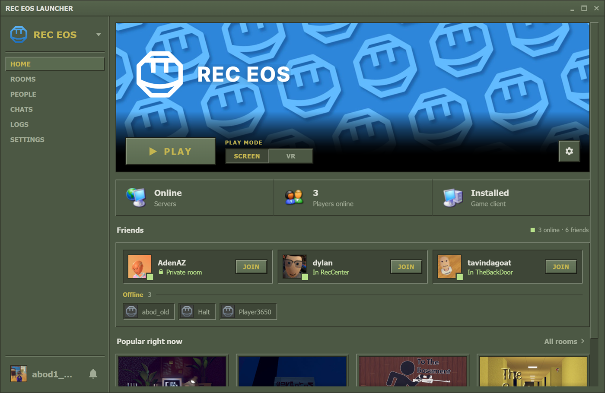
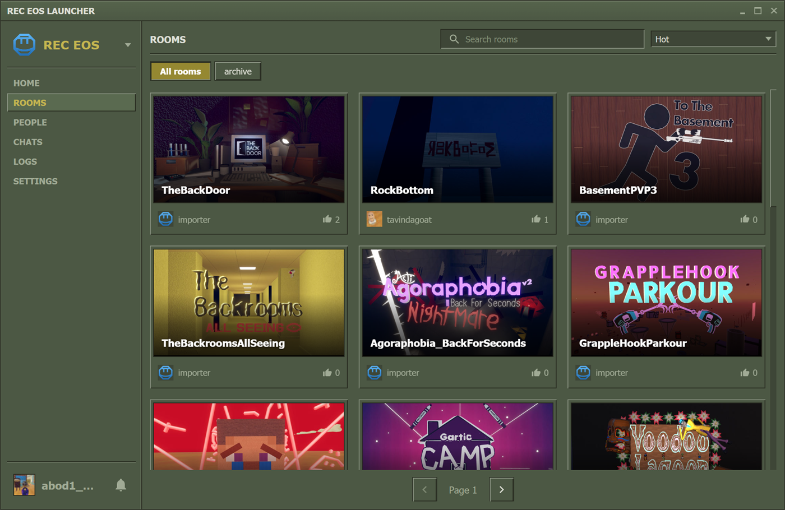
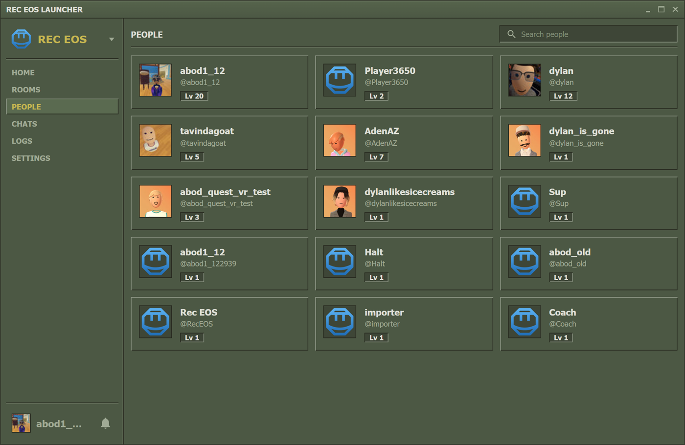
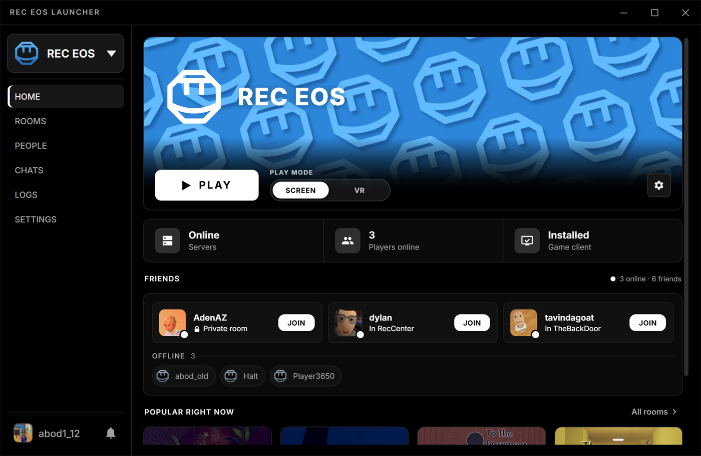
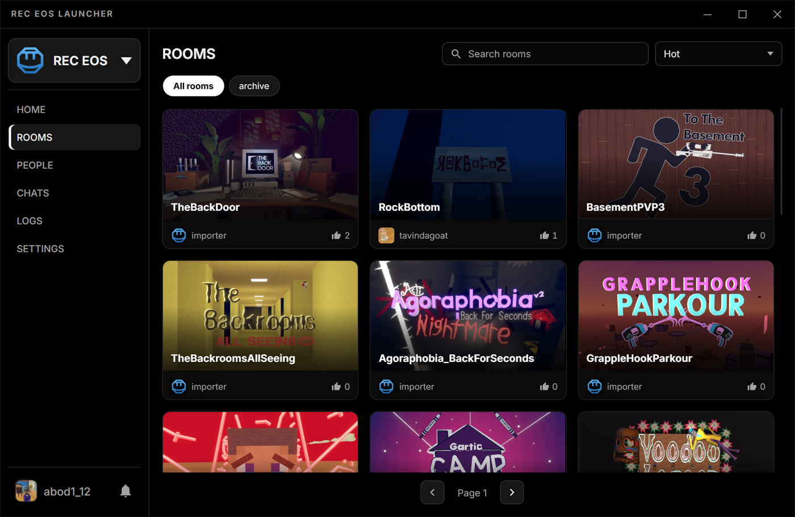
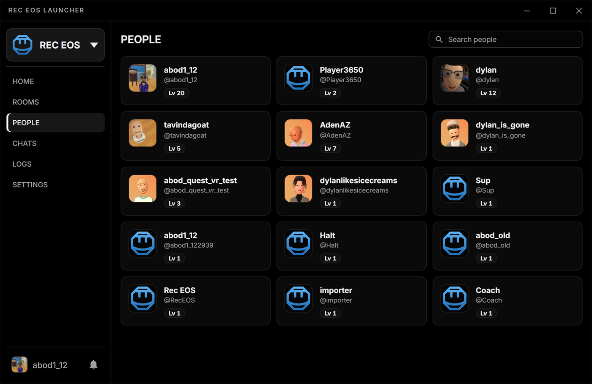
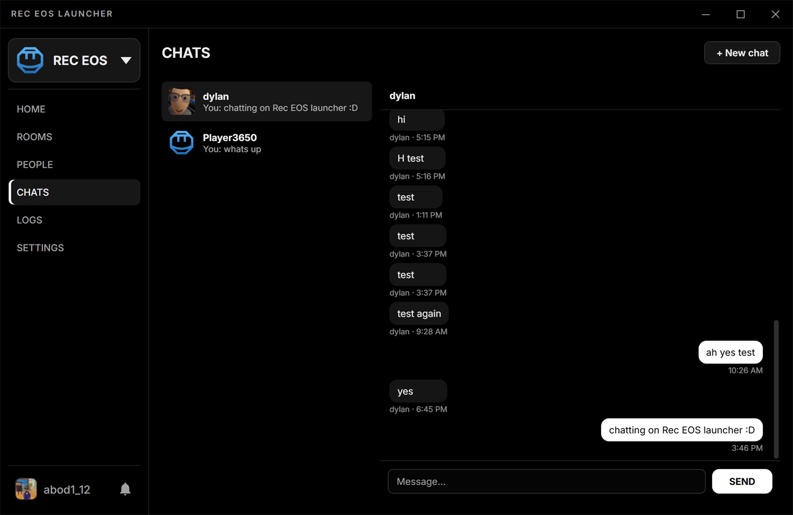
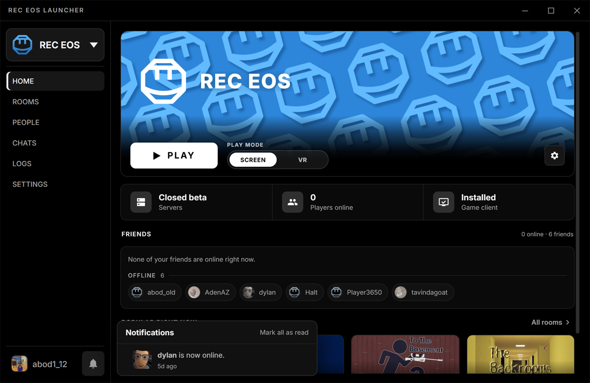
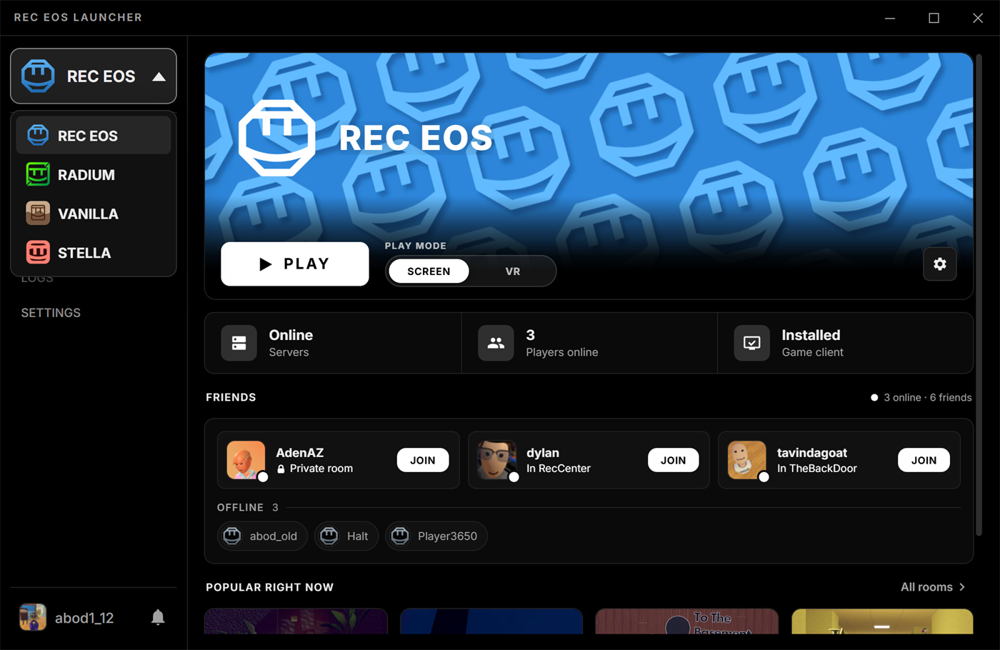
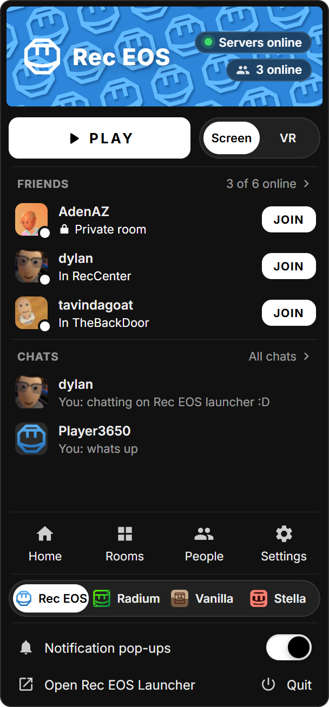

# Rec EOS Launcher

_Formerly Radium Launcher._

An **unofficial** launcher for Rec Room revival servers.

| Server | Site |
| :--- | :--- |
| **Rec EOS** (default) | [rec-eos.com](https://rec-eos.com/) |
| **Radium** | [radie.app](https://www.radie.app/) |
| **Vanilla** | [vanillarec.net](https://vanillarec.net/) |
| **Stella** | [Discord](https://discord.com/invite/stella-rr) |

## Showcase

### Steam 2003 Green Theme
| Home Tab | Rooms Tab | People Tab |
| :---: | :---: | :---: |
|  |  |  |

### Black & White Theme
| Home Tab | Rooms Tab | People Tab |
| :---: | :---: | :---: |
|  |  |  |

### New in 4.0 (Black & White Theme)
| Chats | Notifications |
| :---: | :---: |
|  |  |

| Four networks in one launcher | Tray menu |
| :---: | :---: |
|  |  |

---

## Features

- **Switch servers** — Swap between Rec EOS, Radium, Vanilla and Stella from the
  sidebar or the tray menu. Each keeps its own client install, so all of them can be
  installed at once.
- **Rec EOS** — Downloads the stock client, then patches in the Rec EOS mod from its
  signed update server (every file is checked against the release signature before
  it's installed). Sign in to see your friends and who's online, JOIN a friend or PLAY
  a room straight from the launcher, cheer and favorite rooms, get notifications and
  game invites, and chat with friends in the **Chats** tab.
- **Stella** — Signs in with your Steam account: friends with live presence, JOIN,
  invites and notifications, and keeps Stella's patch up to date.
- **Notifications** — Invites, friend requests and new chat messages show in each
  network's bell and as desktop pop-ups (held back while the game is running, so a
  full-screen game isn't interrupted).
- **Tray menu** — Right-click the tray icon for a skinned panel: PLAY, download
  progress, Screen / VR, your friends with JOIN, your Rec EOS chats, the pages, and
  the network switcher.
- **Browse** — Rooms with search, tag filters and sorting; player profiles with photos
  and rooms; and a live feed of what players are doing right now.
- **Client management** — Downloads and extracts the game client in-app with live speed
  and ETA, resumes interrupted downloads, checks the download against a pinned hash,
  repairs a damaged install, detects outdated installs, and launches the game.
- **15 skins** — Steam 2003 Green, Windows 95 / 98 / XP / Vista / 7, Mac OS Classic and
  Aqua, Modern Dark and more — plus a **Liquid Glass** effect with your own tint or
  background picture.
- **Diagnostics** — A searchable, filterable log that is kept on disk for each session,
  a Report a Problem dialog that shows exactly what it sends (and can attach the session
  that crashed), server status on startup, and third-party antivirus detection.
- **Stays current** — Checks GitHub for signed launcher updates on startup and while it
  sits in the tray, and saves every setting the moment you change it.

---

## Download

**Update 4.0.0 (Rec EOS Launcher) is coming soon.** Until it's published, grab the
current build from the [Releases page](https://github.com/abod124-sudo/Radium-Launcher/releases/latest).
It's an installer for Windows x64.

Already on Radium Launcher? 4.0.0 installs over it and keeps your settings and game
files; it just has the new name.


## File Locations

```
%APPDATA%\com.radium.launcher\
  ├── config.json         - saved settings
  ├── client-receos\      - Rec EOS game files
  ├── client\             - Radium game files
  ├── client-vanilla\     - Vanilla game files
  └── client-stella\      - Stella game files
```

Each game folder can be moved in Settings → Folders. Uninstalling one server never
touches the others.

---

## Building from source

Requires the [Rust toolchain](https://rustup.rs/) and Node.js.

```bash
npm install
npm run dev     # run the launcher
npm run build   # produce the installer
cd src-tauri && cargo test
```

On an ARM64 PC (a Surface Pro, say), use `npm run dev:x64` and `npm run build:x64`
instead. The Steamworks SDK ships its Windows library for x64 only, so an ARM64
build fails to link; the x64 build runs under Windows' emulation. The target
needs adding once: `rustup target add x86_64-pc-windows-msvc`.

---

## Note

Parts of this launcher's codebase were written/co-authored with the help of AI coding assistants.
